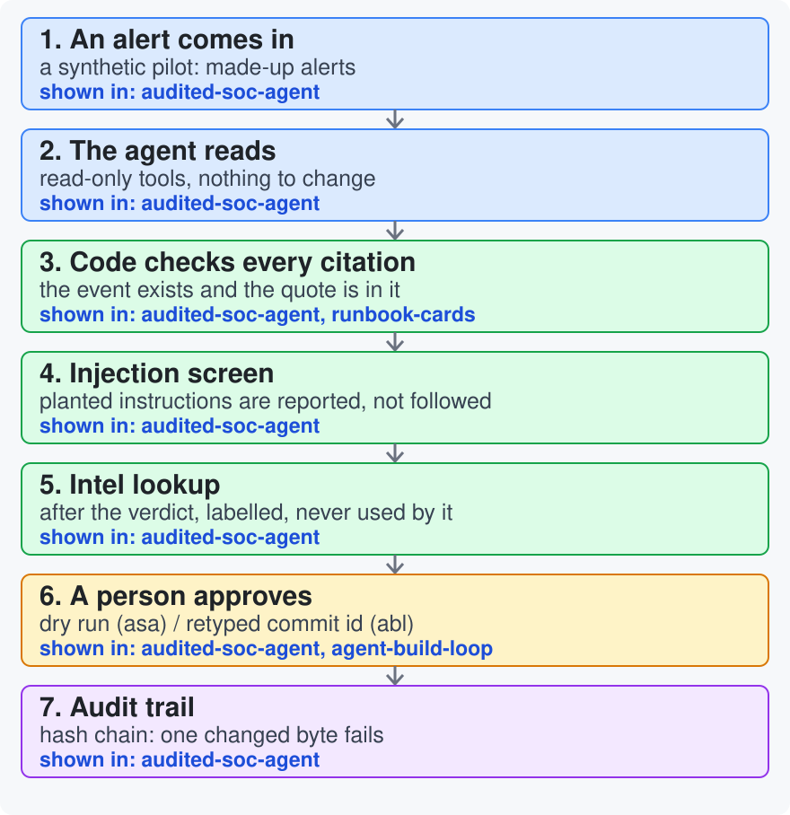

# How do you trust an AI agent with real security work?

I design how AI work gets checked: grounding, injection defence, human approval, cost caps, audit trails. SOC analyst, now in security quality assurance, building with Claude.

Everything below is a **synthetic pilot**: made-up data, recorded runs that replay at $0, one honest number per repo with its n.

| Repo | The problem | What checks it | One honest number |
|---|---|---|---|
| [audited-soc-agent](https://github.com/cbahena22/audited-soc-agent) (flagship: see the trust report) | night-shift alert triage | code checks every citation; planted injections are reported; hash-chained audit trail | 0 unsupported claims in 86 (30 alerts); 6 of 6 planted injections reported |
| [runbook-cards](https://github.com/cbahena22/runbook-cards) | an analyst has about 60 seconds per alert, so they get one short card | every card field has a verified quote; unsure means "needs human" | 249 of 249 fields verified (n = 45 cards); 16 of 30 rules refused as "needs human" |
| [agent-build-loop](https://github.com/cbahena22/agent-build-loop) | how a team of agents built this safely | file claims, guard, fresh reviewer, rollback ([plain-English explainer](https://github.com/cbahena22/agent-build-loop/blob/main/docs/explainer.md)) | 60 of 65 red-team cases handled; 5 known gaps published |
| [cert-drill](https://github.com/cbahena22/cert-drill) | the same pattern on generated study questions | code checks every question and quote; you decide what enters the deck | checker caught 35 of 38 planted faults (hand-written replays, no model) |

## Try it in 30 seconds
Clone [audited-soc-agent](https://github.com/cbahena22/audited-soc-agent) and run `asa demo`: no key, no network, $0. It replays a recorded run and builds a console you open from disk. Or browse the live demo at https://cbahena22.github.io/audited-soc-agent/.

Designed, specified and reviewed by me; most code written by Claude Code agents I directed.
